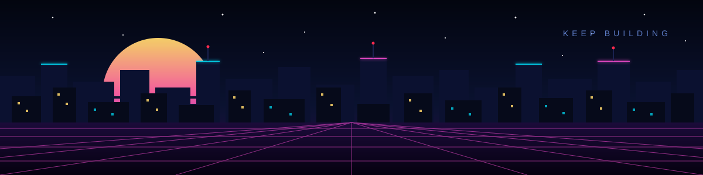

<h1>Rubisma Baruna Cakra</h1>

**Informatics Engineering Student | Building better things, one commit at a time.**

📍 Indonesia &nbsp;|&nbsp; 📅 Joined on 2024

---

## 🛠️ Tech Stack

  
  
  
  
  
  
  
  
  
  
  

---

## 📊 GitHub Stats & Top Languages

  
  

 

  

---

